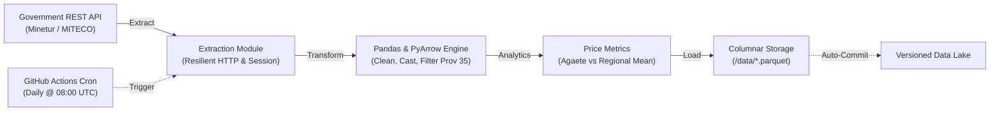

# ⛽ Gran Canaria Fuel Data Pipeline (ETL)

[](https://github.com/yonillo/gc-data-hub-pipeline/actions/workflows/main.yml)
[](https://www.python.org/)
[](https://parquet.apache.org/)
[](https://github.com/features/actions)
[](https://www.docker.com/)

Automated production Data Engineering (ETL) pipeline that ingests, cleans, analyzes, and persists daily fuel station prices across the province of Las Palmas (Gran Canaria, Spain), with micro-regional price differential analytics focused on **Agaete**.

---

## 🏗️ Architecture & Data Flow



1. **Extract (`src/extract.py`):** Ingests live data from Spain's Ministry of Industry and Energy REST API. Features connection resilience with automated retries and exponential backoff.
2. **Transform (`src/transform.py`):** Cleans decimal encodings, normalizes numeric datatypes, filters geographic records for Las Palmas (`IDProvincia: 35`), and computes comparative variance metrics.
3. **Load (`src/load.py`):** Serializes clean data into **Apache Parquet** columnar format, creating daily snapshots and updating the `latest` pointer.

---

## 💡 Engineering & Business Impact

- **Storage Efficiency:** Migrating from CSV to **Apache Parquet** achieves an **~80% reduction in storage footprint**, maintaining strict columnar schemas and high compression ratios.
- **Zero-Cost Serverless Orchestration:** Daily ingestion scheduled via GitHub Actions cron runners with automated CI/CD push to storage.
- **Fast Analytics:** Downstream query latency reduced by columnar projections and typed schema preservation.

---

## 📂 Repository Structure

```
gc-data-hub-pipeline/
├── .github/workflows/
│   └── main.yml           # Automated daily cron workflow (08:00 UTC)
├── config/
│   └── settings.py        # Pipeline parameters & paths
├── data/
│   ├── fuel_prices_latest.parquet
│   └── fuel_prices_gc_*.parquet
├── src/
│   ├── extract.py         # REST API ingestion & error handling
│   ├── transform.py       # Data cleansing & price transformations
│   ├── load.py            # Apache Parquet serialization
│   ├── main.py            # ETL orchestrator
│   └── utils/
│       └── logger.py      # Structured UTF-8 logging
├── Dockerfile             # Multi-platform container definition
├── requirements.txt       # Pinned production dependencies
└── README.md
```

---

## 🚀 Getting Started

### 1. Local Setup

```bash
# Clone the repository
git clone https://github.com/yonillo/gc-data-hub-pipeline.git
cd gc-data-hub-pipeline

# Create virtual environment
python -m venv .venv
source .venv/bin/activate  # On Windows: .venv\Scripts\activate

# Install dependencies
pip install -r requirements.txt

# Run the pipeline
python src/main.py
```

### 2. Run with Docker

```bash
# Build the container
docker build -t gc-fuel-pipeline .

# Execute ETL inside container
docker run --rm -v $(pwd)/data:/app/data gc-fuel-pipeline
```

---

## 👨‍💻 Author

**Yone Suárez Viera**  
Data Science & Engineering Student @ ULPGC | Gran Canaria 🏝️  
- **LinkedIn:** [yone-suarez](https://linkedin.com/in/yone-suarez)
- **Portfolio:** [yonesuarez.es](https://yonesuarez.es)
